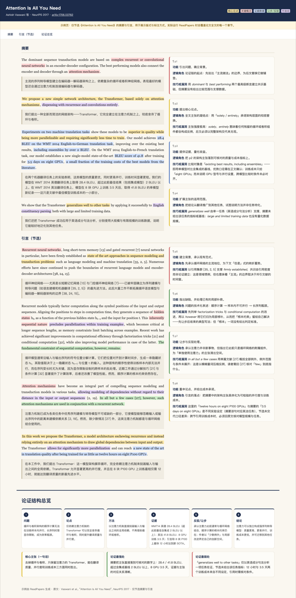

# ReadPapers

把学术论文 PDF 变成「英中双栏 + 五色论证标注 + 逐段批注」的单文件 HTML 网页。

[](LICENSE)

> 不输出摘要。摘要把论证结构再压平一次，正确、完整、且毫无用处。
> ReadPapers 输出的是标注：给论文每一句话贴上论证标签，逼着读者判断——这句是在立论、在给证据，还是在打太极。



## 它解决什么问题

读完一篇论文，最难回答的往往不是「它说了什么」，而是「它是怎么说服我的」。

普通的 AI 总结回答前者，ReadPapers 回答后者。它把论文切成段落，逐段给出：

- **英文原文**：保留原话，关键内容用五色高亮
- **中文意译**：像中文学术论文一样流畅，不加高亮，不替代原文
- **右侧批注**：这段在干嘛、在论证链的哪个位置、用了什么技巧或哪里有漏洞
- **底部总览**：问题 → 论点 → 方法 → 证据 → 反驳/让步 → 结论，外加最强处与最弱处

产出是单个 `.html` 文件，零外部依赖，双击即可离线阅读，可归档、可打印、可发给同门。

## 五色标注

| 颜色 | 维度 | 它回答的问题 |
| --- | --- | --- |
| 🟡 黄 | 核心论点 / thesis | 作者到底想让我相信什么？ |
| 🔴 红 | 关键概念 / 术语 | 哪个词是全文的承重墙？ |
| 🔵 蓝 | 实证证据 / 数据 | 哪些数字在替作者说话？ |
| 🟢 绿 | 让步 / 反驳处理 | 作者预判了谁的攻击，又是怎么拆的？ |
| 🟣 紫 | 方法论说明 | 这个结论，是在什么条件下成立的？ |

五色对应论证骨架：**主张、概念、证据、反驳、边界**。颜色是强制分类，不是装饰。

## 示例

[`examples/demo.html`](examples/demo.html) 用《Attention Is All You Need》的摘要与引言节选演示了完整版式：左侧英中对照与五色标注，右侧逐段批注，底部六格论证总览。

```bash
git clone https://github.com/tsingke/ReadPapers.git
open ReadPapers/examples/demo.html
```

示例只节选了两节；实际运行时 ReadPapers 会覆盖论文全文的每一个章节。

## 安装（Claude Code）

把仓库放进 Claude Code 的技能目录：

```bash
git clone https://github.com/tsingke/ReadPapers.git ~/.claude/skills/ReadPapers
```

重新打开会话后，说出触发词即可使用：`ReadPapers`、`论文批注网页`、`双栏批注`、`五色标注`、`把论文做成网页`、`PDF做网页`、`论证骨架`、`批注式读论文`、`做批注网页`。

## 使用

在会话里给出论文，任选一种方式：

- **本地 PDF**：直接给路径，ReadPapers 会逐页读完（长文分批，不遗漏章节）
- **Zotero 条目**：通过 Zotero MCP 获取全文
- **粘贴文本**：直接贴全文

示例说法：

```text
用 ReadPapers 把 ~/Papers/attention.pdf 做成批注网页
```

**长论文（>20 页）**会先提取完整章节目录并展示，再按章节分批写入同一个 HTML，最后核对节数。不会偷偷截断。

输出文件名默认为 `{论文短名}-批注阅读.html`，放在论文同目录。

## 产出结构

```text
┌──────────────────────────────────────────────────────────┐
│ 顶部导航：论文名 · 作者 · 期刊 · 年份 · DOI · 五色图例      │
├──────────────────────────────────────────────────────────┤
│ 章节导航（sticky，可跳转）                                 │
├────────────────────────────┬─────────────────────────────┤
│ 左栏：英中对照               │ 右栏：逐段批注               │
│  英文原文（五色 span）       │  段落功能                    │
│  ─────────────────           │  逻辑角色                    │
│  中文意译（米色块）          │  技巧或漏洞（必须有依据）     │
├────────────────────────────┴─────────────────────────────┤
│ 底部：问题 → 论点 → 方法 → 证据 → 反驳/让步 → 结论          │
│       核心主张 · 论证最强处 · 论证最弱处                    │
└──────────────────────────────────────────────────────────┘
```

桌面端双栏，≤900px 自动单栏，打印时隐藏导航并避免段落跨页断裂。

## 仓库结构

```text
ReadPapers/
├── SKILL.md                  # 技能定义：流程、铁律、交付方式
├── references/
│   ├── prompt.md             # 生成提示词与验收标准
│   └── html-spec.md          # HTML 结构、CSS 变量、组件类名
├── examples/
│   └── demo.html             # 示例批注网页
├── docs/
│   └── preview.png           # 示例预览图
├── README.md
├── LICENSE
└── .gitignore
```

## 不装 Claude Code 也能用

`references/prompt.md` 是一份完整的生成提示词，可以直接粘贴给任何支持长文本的模型，再配合 `references/html-spec.md` 约束输出样式。技能化的部分只是把流程、自检与交付话术固定下来。

## 三条铁律

1. **逐字引用**：所有直接引用的原句必须逐字来自论文，不得改写；关键数据标注所在章节。模型很容易编出「作者在 4.2 节也承认了这一点」，而原文根本没有 4.2 节。
2. **长文分节不省略**：三十页以上论文必须按目录分批生成，节数可核对。绝不偷偷截断后补写。
3. **漏洞批评必有依据**：没有依据的批评不写。被要求找漏洞时，模型会硬找——看到一条「潜在漏洞」先问：这是真漏洞，还是没读懂？

## 已知边界

- 扫描版 PDF 没有文本层时，需要先 OCR；ReadPapers 不会对图片凭空编造内容。
- 批注是阅读假设，不是判决。引文、数字、章节号请回原文抽查。
- 英文学术写作里的 `may`、`might`、`suggests`、`is consistent with` 有分寸，中文翻译容易抹平。判断作者有多确定时，看英文，不看中文。

## License

[MIT](LICENSE)
